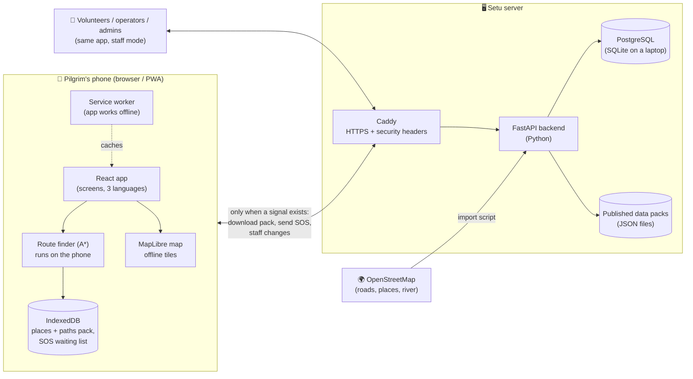
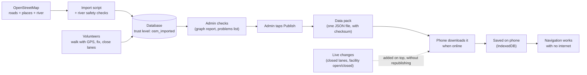
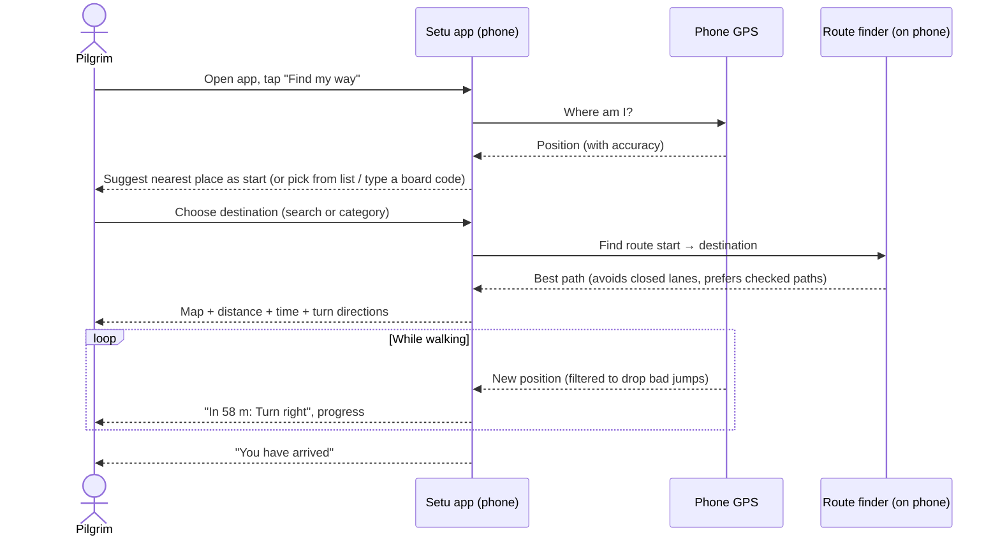
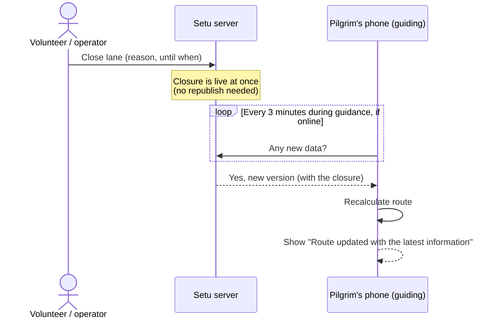

# Setu: project deep dive

A step-by-step guide to the whole project, written for someone who is new to
it and has to explain it in a demo. Read it top to bottom once. Before the
demo, read sections 1, 3 and 12 again.

*Last updated 3 Nov 2026, after three code reviews and a full end-to-end live
test in Chrome (commit `2951126`).*

**Contents**

1. [Setu in one minute](#1-setu-in-one-minute)
2. [The problem and the idea](#2-the-problem-and-the-idea)
3. [How to run it for the demo](#3-how-to-run-it-for-the-demo)
4. [The big picture: architecture](#4-the-big-picture-architecture)
5. [Who uses it: the four roles](#5-who-uses-it-the-four-roles)
6. [The main workflows, step by step](#6-the-main-workflows-step-by-step)
7. [Tools, libraries and frameworks](#7-tools-libraries-and-frameworks)
8. [Where the code lives: folder map](#8-where-the-code-lives-folder-map)
9. [Data: what is stored and where](#9-data-what-is-stored-and-where)
10. [Security and privacy](#10-security-and-privacy)
11. [Testing: how we know it works](#11-testing-how-we-know-it-works)
12. [Honest status: done and not done](#12-honest-status-done-and-not-done)
13. [Questions you may be asked](#13-questions-you-may-be-asked)
14. [Glossary](#14-glossary)

---

## 1. Setu in one minute

> **Setu** ("bridge") is a phone app that helps pilgrims at the **Nashik
> Kumbh Mela 2027** find their way on foot to ghats, temples, medical camps,
> toilets, parking and help points. **It keeps working with no internet.**

- **No app store needed.** It opens in the phone's browser and can be added to
  the home screen (a "PWA", or Progressive Web App).
- **Offline first.** After one visit online, the phone keeps the map, the places
  and the walking paths. Route finding runs **on the phone**, not on a server.
- **Safety first.**
  - Routes never cross the river unless there is a mapped bridge.
  - Closed paths are avoided.
  - The app always says how trustworthy each path is.
- **Three languages:** English, Hindi (हिंदी) and Marathi (मराठी).
- **Staff tools:**
  - **volunteers** map and check paths, and report problems;
  - **operators** handle SOS alerts;
  - **admins** check and publish the data.
- **Built-in emergency help:**
  - an SOS button;
  - quick-dial buttons for 112 (national emergency number) and 108 (ambulance);
  - an "Ask Setu" helper that works offline.

**Status:** all 8 planned software phases are built and tested on computers.
On 3 Nov 2026 the whole app was used end to end in Chrome (pilgrim,
volunteer, operator, admin), and every problem seen was fixed. It has **not
yet been tested in Nashik or on real phones in the field** (section 12).

---

## 2. The problem and the idea

### The problem

- Crores of people come to Nashik for the Kumbh Mela. Many are first-time
  visitors, elderly, or don't read English.
- **Mobile networks jam** in big crowds. An app that needs the internet to
  show a map or a route stops working at the worst moment.
- **The river (Godavari) splits the area.** A wrong route through water or a
  closed lane can be dangerous.
- Plans change on the day: lanes are closed for crowd control, and facilities
  open and close.

### The idea

| Problem | Setu's answer |
|---|---|
| No network in crowds | Everything needed to navigate is saved on the phone in advance |
| People don't read English | Full Hindi and Marathi screens and turn directions |
| Dangerous routes | River safety checks, closed lanes avoided, trust labels on every path |
| Plans change | Staff close lanes; phones pick up changes whenever they get a signal, even during a walk |
| Emergencies | SOS that waits on the phone and sends when there is a signal, plus 112/108 call buttons |
| Unknown data quality | Every path has a **trust level** (from "imported from the map, not checked" up to "officially verified") |

---

## 3. How to run it for the demo

### 3.1 Start everything (one command)

```bash
cd /home/stark/workspace/Kumbh/Kumbh-Wayfinding
USE_TUNNEL=0 ./start.sh
```

- `start.sh` installs what it needs, builds the app and starts two servers.
  The first run takes a few minutes; later runs are faster.
- `USE_TUNNEL=0` keeps it **on this computer only**. Without it, the script
  opens a public ngrok link for phones. Only do that if you mean to share the
  app with phones, and only with testers.
- Port 8000 on this computer is used by another project. **The script notices
  this and moves the backend to 8010 by itself.** That is expected.
- **First run only:** it creates a local security certificate and adds it to
  Chrome's trusted list **on this computer**, so `https://localhost` opens
  without a warning. Fully quit Chrome and open it again afterwards. If that
  step fails, Chrome shows "Not secure": choose **Advanced → Proceed**.
- When it prints **"Routefinding is running"**, open the address it shows:
  `https://localhost:5173`.
- To stop, press **Ctrl+C** in that terminal.
- **To show publishing exactly as in production** (changes wait until an admin
  taps Publish), start it with `PUBLISH_MODE=manual USE_TUNNEL=0 ./start.sh`.
  Without it, a laptop publishes every change at once.

### 3.2 Pretend you are in Nashik (simulation)

You are in Pune, so the real GPS would put you far away. Use simulation:

```
https://localhost:5173/?sim=1
```

- A striped **SIMULATION MODE** banner appears, and a panel lets you place
  yourself at a spot in Nashik and "walk" along the route.
- It uses the real app logic (same route finder, same guidance). Only the
  position is fake.
- It **never exists in the real public version** of the app. It is a testing
  tool only.

### 3.3 Suggested demo script (about 12 minutes)

Every step below was done live in Chrome on 3 Nov 2026 and worked.

**Pilgrim (about 6 minutes)**

| # | Show | Say |
|---|---|---|
| 1 | First screen: **"I am a visitor" / "I am a volunteer"**. Tap visitor. Reload: it goes straight to the visitor home | "No account for pilgrims. The phone remembers the choice; the back arrow brings it back." |
| 2 | Change language to हिंदी, then मराठी, then back | "Built for pilgrims who don't read English." |
| 3 | "Download offline map" card, then the "Offline data from … · N places" line | "Everything is stored on the phone. No network needed after this." |
| 4 | Find my way → start **Ramkund Ghat** → type **कालाराम** in the search | "You can search in Hindi or Marathi even when the map data only has English names." |
| 5 | Point out the destination list: **nearest first, with distances** | "The closest help is at the top." |
| 6 | Route on the map: about 413 m, 6 min, turn directions ("In 58 m: Turn right") | "The route is calculated on the phone in milliseconds, in three languages. It shows how trustworthy each path is." |
| 7 | In the simulation panel, walk the route, step off it, then walk to the end | "If you go the wrong way, it finds a new route from where you are. Then: 'You have arrived'." |
| 8 | Ask Setu: "nearest toilet", then **"आग"** or **"वाचवा"** (Marathi "save me") | "Offline helper. An emergency question always shows Call 112, Call 108 and SOS first." |
| 9 | Tap SOS from there: the kind is already chosen, the screen says what will be sent | "The alert waits on the phone until there is a signal. It never says 'sent' until the Setu server confirms it." |

**Staff (about 5 minutes)**

| # | Show | Say |
|---|---|---|
| 10 | Back arrow → "I am a volunteer" → sign in as operator. SOS inbox: acknowledge with a quick reply ("A volunteer is coming to you") | "The pilgrim sees the reply in their own language: Hindi or Marathi." |
| 11 | As a pilgrim on a route, tap **"Path blocked"**. As a volunteer, open the report list: "map road · near Ramkund Ghat (5 m)". Confirm it, then reopen it | "Pilgrims report, a volunteer checks, the lane closes for everyone's route finder. Reopening puts it back." |
| 12 | Admin (started with `PUBLISH_MODE=manual`, 3.1): change a trust level → it says it waits for Publish → **Publish** → **Rollback** | "Nothing reaches pilgrims until an admin publishes it. A bad version can be undone. Every change is logged." |
| 13 | Admin: create a QR board code and show the print preview | "Each board has a QR code and a short code a pilgrim can type with no camera." |

**Close (1 minute)**

| # | Say |
|---|---|
| 14 | "The software is complete and was tested end to end on computers. Next comes the field pilot in Nashik: walking the paths, real phones, and approvals." (section 12) |

> **Optional, airplane-mode demo:** after the app has loaded once, stop the
> servers (Ctrl+C) and reload the page. The app still opens, still has its
> places and still finds routes. Ask Setu still works, and an SOS waits on the
> phone. This is the strongest proof of "offline first".

### 3.4 Prepare before the demo (do this the day before)

1. Start the app once (3.1) so the first-run setup is done.
2. **Create staff accounts** for steps 10–13: one admin is enough to show
   everything (section 6.5). Keep the PIN private; don't show it on screen.
3. Open `https://localhost:5173/?sim=1`, tap **Download offline map** and wait
   until it finishes.
4. Walk through the script once, start to finish.
5. If you will show steps 11–12, remember that they change the local data.
   Reopen the lane and roll back afterwards, or use a copy of
   `backend/setu_local.db`.

### 3.5 If something goes wrong during the demo

| What you see | What to do |
|---|---|
| Chrome asks for your location, or puts you in Pune | Use the `?sim=1` address and place yourself in Nashik from the panel |
| "Not secure" warning | **Advanced → Proceed** (it is this computer's own certificate) |
| The map is blank or grey | Tap **Download offline map** while online, or reload once |
| "A new version of the app is ready" | Tap **Reload**. This is the app's safe update prompt |
| The volunteer screen is missing | Use the back arrow on the visitor home, or open `/?mode=volunteer` |
| Port 8000 message in the terminal | Expected: the backend moves to 8010 by itself |
| Map labels are English while the screen is Hindi/Marathi | Expected (section 12). Lists, search, cards and directions are in the chosen language |

---

## 4. The big picture: architecture

### 4.1 The parts



**The key idea in one sentence:** the server *prepares and publishes* the
data; the phone *downloads it once and then does all the navigation itself*.

### 4.2 The layers in plain words

| Layer | What it is | What it does |
|---|---|---|
| **Frontend** (`frontend/`) | A website written in React + TypeScript, installable as an app | Every screen: pilgrim navigation, Ask Setu, SOS, volunteer, operator and admin tools |
| **Offline engine** (inside the frontend) | Service worker + IndexedDB + Cache Storage | Keeps the app, the map and the data on the phone |
| **Route finder** (`frontend/src/lib/router.ts`) | The A* algorithm | Finds the best walking path between two places, on the phone |
| **Backend** (`backend/`) | A Python web server (FastAPI) | Accounts, saving staff changes, SOS inbox, data checks, publishing packs |
| **Database** | PostgreSQL in production, SQLite file on a laptop | Places, paths, accounts, alerts, audit log |
| **Data pipeline** (`backend/scripts/import_osm.py`) | A script | Pulls Nashik roads, places and river shapes from OpenStreetMap, with safety checks |
| **Deployment** (`deploy/`) | Docker + Caddy | How it would run on a real server (not deployed yet) |

### 4.3 How data flows (from map to pilgrim)



---

## 5. Who uses it: the four roles

| Role | Signs in? | What they can do |
|---|---|---|
| **Visitor / pilgrim** | No account | Navigate, download the offline map, Ask Setu, send SOS, report a blocked lane, type a board code |
| **Volunteer** | Phone number + 6-digit PIN | Add and fix places, walk and record paths with GPS, mark obstacles, close or reopen lanes |
| **Operator** | Same sign-in | Everything a volunteer can do, plus the SOS inbox (acknowledge, resolve), the operations summary, and lost-person cases (switched off in production for now) |
| **Admin** | Same sign-in | Everything, plus data checks, verifying paths, facility status, QR board codes, publishing, rollback and the audit log |

The visitor never needs an account. **Their location never leaves the phone**
for navigation (section 10).

---

## 6. The main workflows, step by step

### 6.1 Pilgrim: find the way



**Steps:**

1. **Where am I?**
   - The app reads GPS. If the fix is good (within about 30 m), it suggests the
     nearest place. If it is weak, it says so and asks you to pick.
   - You can also type the code from a **Setu board** at the place, which works
     offline.
2. **Where to?**
   - Search by name or browse by category: ghat, temple, medical, toilet,
     parking, help…
   - The list is **nearest first, with the distance**.
   - **Search works in Devanagari.** Most names in the map data are English
     only, so the app spells a Hindi/Marathi word out in Latin letters and
     compares the sound: "कालाराम" finds Kalaram Mandir, "रामकुंड" finds
     Ramkund.
3. **The route.**
   - The phone runs the **A\* route finder** on the saved data.
   - It skips blocked or closed paths, prefers checked paths and wider lanes, and
     never uses an unapproved river crossing.
4. **Guidance.**
   - Turn directions are shown in the chosen language.
   - The GPS filter ignores sudden jumps (more than 35 m), so the guidance doesn't jump around.
5. **Wrong way?** It works out a new route from the nearest point of the
   network (within 50 m, never across the river), and shows "new way from
   here" for 15 seconds.
6. **Arrival** happens within 20 m of the destination.

> **Visitor or volunteer?** The first screen asks once. The phone then
> remembers "I am a visitor", so a pilgrim goes straight to the map next time.
> The back arrow on the visitor home brings the choice back.

### 6.2 Offline behaviour

1. **First visit online:**
   - the service worker saves the app itself;
   - the app downloads the **data pack** (places and paths, about 150 KB compressed) into IndexedDB.
2. **"Download offline map"** saves about 9 MB of map pieces (1,784 files).
   If interrupted, it continues where it stopped.
   - **Map labels are drawn in English.** The map engine (MapLibre) can't join
     Hindi/Marathi letters correctly, so a Devanagari label would look broken.
     Everything else (lists, search, place cards, turn directions, buttons)
     is in the chosen language, because the browser draws those correctly.
3. **Later, with no internet:**
   - the app opens from the phone, the map draws from the saved pieces, and routes are calculated on the phone;
   - the server is not needed at all.
4. **Updates are safe:**
   - a new pack is fully downloaded and checked (checksum) **before** it replaces the old one;
   - a damaged copy is detected and removed;
   - updates never interrupt a walk.
5. **Old data warning:** if the phone hasn't confirmed its data for 12 hours, it
   shows a warning that the data may be old.
6. **App updates:** when a new version of the app is out, it shows "A new
   version of the app is ready" with a **Reload** button. It never reloads by
   itself, so a walk is never interrupted.

### 6.3 A lane is closed during a walk



- During guidance the phone checks for news **every 3 minutes** when it has a
  signal. It also checks when the app opens, when it comes back to the screen,
  and when the network returns.
- The message appears **only** if the route really changed. In the tested case
  the route went from 413 m to 453 m.

**Where closures come from: a pilgrim's report (tested live)**

1. A pilgrim on a route taps **"Path blocked"**. The report names the lane.
2. A volunteer opens the report list. It appears at once, nearest first, and
   names each lane in plain words, for example "map road · near Ramkund Ghat
   (5 m) · 1 visitor · 20 min ago".
3. The volunteer **confirms** it (the lane closes for everyone) or rejects it.
4. When the way is clear, the volunteer **reopens** the lane, and phones route
   through it again.

Pilgrim reports never close a lane by themselves: a person always checks first.

### 6.4 SOS (emergency alert)

1. The pilgrim taps **SOS**, picks a kind (medical help, someone is lost, unsafe crowd, other help), and
   can add a short note.
2. The screen **says what will be sent** (kind, note, position if allowed,
   nearest place) and who gets it.
3. The alert is saved **on the phone first**, then sent. With no signal, it
   waits and sends itself as soon as there is one.
4. **Operators** see it in the SOS inbox, **acknowledge** it, then **resolve**
   it. The pilgrim's phone shows each status.
5. **Quick replies:** the operator can pick a ready reply ("A volunteer is
   coming to you", "Go to the nearest help desk", "Stay where you are — help is
   coming"). The pilgrim sees it **in their own language**.
6. Old alerts are deleted automatically (section 10).

> **Important:** Setu's SOS goes to the **Setu operator console**, not to 112.
> The app shows separate **Call 112 / Call 108** buttons for the official
> services. It never claims an alert was delivered unless the Setu server
> really answered. A Wi-Fi sign-in page (for example at a station) that
> "answers" in place of the server doesn't count, and the alert stays waiting.

### 6.5 Volunteer: map and check paths

1. **Get an account** (an admin creates it on the server):
   ```bash
   cd backend
   .venv/bin/python scripts/manage_volunteers.py add 98XXXXXXXX "Name" --role admin
   # it asks for a 6-digit PIN (typed, never on the command line)
   ```
   Roles: leave out `--role` for a volunteer, or use `--role operator` / `--role admin`.
2. Open `https://localhost:5173/?mode=volunteer` (or tap the back arrow on the
   visitor home, then "I am a volunteer"), then sign in with the phone number and PIN.
3. **What volunteers do:**
   - **add or fix a place** (standing there, using GPS);
   - **record a walk:** walk a lane with GPS on, and it is saved with the real track;
   - **mark an obstacle**, or **close/reopen a lane**, with a reason and an end time;
   - **review visitor reports** of blocked lanes (confirm or reject).

   Lanes are named in plain words: the street name when the map has one, and
   the nearest place, for example "map road · near Ramkund Ghat (5 m) · #2293".
4. **Recording a walk is careful about GPS errors**, because the walked length
   becomes the lane's length for routing:
   - a GPS reading worse than ±30 m is ignored;
   - standing still adds nothing (before this fix, standing for minutes could
     turn a 200 m walk into 870 m);
   - the walk must start at the chosen start place and end at the new place,
     or the app explains what is wrong;
   - the compass direction is saved only when the phone gives a real
     north-based reading.
5. **No signal?** Changes wait in an **outbox** on the phone and are sent later.
   A unique key stops the same change from being saved twice.
6. Everything they save is labelled with a trust level. A walked lane counts
   as **volunteer verified**. Nothing simulated can ever be marked verified.

### 6.6 Admin: check and publish

1. **Checks screen:** a graph report lists problems, such as places nobody can
   reach, lanes crossing water and unchecked links.
2. **Verify:** set the trust level of places and lanes (e.g. "remotely reviewed",
   "officially verified"). Unsafe items can be **rejected**: kept for the record
   but never used.
3. **Facility status:** mark a place open, limited or closed, **with an end
   time** after which the app stops claiming it.
4. **Board codes:** create a code for a place and print its board (QR + code).
   If the app is open on a test address (localhost, a home network, ngrok),
   the print screen **warns** that the board would point there. Real boards
   need the public address set first (`VITE_PUBLIC_ORIGIN`).
5. **Publish:** creates a new data pack. Phones pick it up the next time they are
   online. **Rollback** returns to an earlier pack if something is wrong.
6. **Audit log:** who changed what, and when.

**What waits for Publish and what is live at once (production):**

| Change | When phones see it |
|---|---|
| New places, new lanes, a **higher** trust level | After the admin taps **Publish** |
| A lane closed or reopened, a facility opened or closed | At once (safety can't wait) |
| A trust level **lowered**, or an approval taken back | At once, and a rollback can't bring it back |

### 6.7 Ask Setu (the offline helper)

- You type a question, for example "nearest toilet", "पास में डॉक्टर",
  "is the ghat open?".
- **Emergency words are checked first.** Words such as fire, injured, drowning,
  "help me", आग, बचाओ and वाचवा trigger an emergency box with **Call 112, Call 108, Send SOS**
  and the nearest medical/help/police points.
- Otherwise it answers from the saved data: nearest place of a kind, a
  facility's status, or safety tips.
- It understands place names typed in Devanagari (same sound matching as the
  search).
- For medical help it lists a **general hospital before a specialist one**
  (an eye or dental hospital counts as 1 km farther), unless you asked for that
  specialty.
- If you then tap SOS, the kind of help is already chosen from your words (you
  can change it).
- **It is not an AI chatbot.** It uses simple rules written in the app, runs
  offline, and sends nothing to any outside service. It never invents a route,
  marks something safe, or makes up whether a facility is open.

### 6.8 Report helper and operations summary (operators)

- **Report helper:** when an operator types a free-text description of a lost person,
  it pulls out age, clothing, place, time, languages and phone, and lists what is
  still missing. The operator checks and confirms. The helper fills in the form
  but never decides anything.
- **Operations summary:** tiles with counts only (open SOS alerts, open cases,
  closed lanes, pending reports). No personal details are shown.

---

## 7. Tools, libraries and frameworks

### 7.1 Frontend (what runs on the phone)

| Tool | What it is | Why we use it |
|---|---|---|
| **React 18** | The most popular library for building screens | All the app's screens are React components |
| **TypeScript 5.6** | JavaScript with type checking | Catches mistakes before the app runs; it even checks that every English text has a Hindi and a Marathi version |
| **Vite 5** | Build tool and development server | Fast builds; turns the code into small files for phones |
| **vite-plugin-pwa (Workbox)** | Makes the site an installable, offline app | Creates the **service worker** that saves the app on the phone |
| **MapLibre GL 6** | Open-source map display (free, no Google key) | Draws the map and the route line |
| **PMTiles + Protomaps basemaps** | A single-file map format and its map style | Lets the whole Nashik map be stored and served offline |
| **IndexedDB** (built into browsers) | A database inside the browser | Stores the data pack, waiting SOS alerts and the volunteer outbox |
| **Cache Storage** (built into browsers) | File storage for the service worker | Stores the offline map pieces |
| **Geolocation API** (built in) | Phone GPS from the browser | Your position. It stays on the phone |
| **qrcode.react** | Draws QR codes | Printing the QR boards (admin) |
| **Fontsource (Figtree, Bricolage Grotesque)** | Fonts bundled with the app | No calls to Google Fonts, so it works offline and keeps privacy |
| **ESLint** | Code style checker | Keeps the code clean (0 warnings) |

**Our own logic (no outside library):**

| File | What it does |
|---|---|
| `lib/router.ts` | A* route finder; avoids closed lanes, prefers checked and wider paths |
| `lib/gpsFilter.ts` | Ignores bad GPS jumps |
| `lib/nearest.ts` | Nearest place to you; where a new route starts after a wrong turn |
| `lib/placeInfo.ts` | Place search, including Devanagari sound matching |
| `lib/walk.ts` | Volunteer walk recording rules (ignores rough GPS and standing still) |
| `lib/navigation.ts` | Progress and arrival |
| `lib/packSync.ts`, `lib/packStore.ts` | Download, check and save the data pack; old-data warning; re-check during walks |
| `lib/mapDownload.ts`, `lib/mapCache.ts` | Offline map download that can resume |
| `lib/sos.ts`, `lib/outbox.ts` | Send-later queues for SOS and volunteer changes |
| `lib/assistant.ts` | Ask Setu rules |
| `lib/reportParser.ts` | Report helper rules |
| `lib/location/` | Real GPS and the separate simulation |
| `i18n/` | English, Hindi, Marathi texts |

### 7.2 Backend (the server)

| Tool | What it is | Why we use it |
|---|---|---|
| **Python 3** | Programming language | Easy to read; good for data work |
| **FastAPI** | Modern Python web framework | Defines the API (45 endpoints); checks every request's data automatically |
| **Uvicorn** | The server that runs FastAPI | Handles the web requests |
| **Pydantic** (+ pydantic-settings) | Data checking and settings | Rejects wrong or oversized input; reads settings from the environment |
| **SQLAlchemy 2** | Talks to the database from Python | The same code works with SQLite and PostgreSQL |
| **PostgreSQL 16** | Production database | Reliable, standard, free |
| **SQLite** | A database in one file | Simple local development (`backend/setu_local.db`) |
| **psycopg2** | PostgreSQL driver | Connects Python to PostgreSQL |
| **python-dotenv, python-multipart, aiofiles** | Helpers | Settings files, form uploads, file serving |
| **hashlib.scrypt** (built into Python) | Slow password hashing | PINs are never stored as plain text |
| **httpx** (development only) | Test HTTP client | Runs the 225 API checks |

**Our own backend modules:**

| File | What it does |
|---|---|
| `app/main.py` | Starts the app, adds the routers, health check |
| `app/auth.py` | Sign-in, PIN lock-out, network rate limit, tokens |
| `app/routers/*.py` | The API: `pack`, `nodes`, `volunteer`, `reports`, `admin`, `sos`, `cases` |
| `app/verification.py` | Trust levels |
| `app/audit.py` | Audit log |
| `app/idempotency.py` | Stops duplicate saves |
| `app/services/pack_builder.py` | Builds the published data pack |
| `app/services/osm_import.py`, `osm_network.py`, `water.py`, `river_guard.py` | OpenStreetMap import and river safety |
| `app/services/graph_report.py` | Data problem report for admins |
| `app/services/retention.py` | Deletes old personal data on schedule |

### 7.3 Data and maps

| Source / tool | Used for |
|---|---|
| **OpenStreetMap** (via the **Overpass API**) | Nashik roads, footpaths, bridges, places and river shapes |
| **Protomaps** basemap | The background map pictures, stored offline |
| `config/approved_crossings.json` | River crossings without a mapped bridge that a person has approved. **Currently empty**, so no such crossing is used |

### 7.4 Deployment (ready, not yet used)

| Tool | Role |
|---|---|
| **Docker + Docker Compose** | Packs the database, backend and web server into containers (`deploy/docker-compose.prod.yml`) |
| **Caddy** | Web server in front; automatic HTTPS certificates; strict security headers (CSP) |
| `deploy/backup.sh` | Database backups |
| **ngrok** (development only) | Temporary public HTTPS link so test phones can use GPS |

### 7.5 Testing and quality tools

| Tool | Checks |
|---|---|
| `frontend/scripts/runRoutingTests.ts` (run with **tsx**) | 240 checks of routing, offline, SOS, assistant, staleness… |
| `backend/scripts/run_api_checks.py` | 225 checks of every API endpoint, roles and security |
| `backend/scripts/smoke_browser.py` + `cdp.py` | Drives a real **headless Chrome** through 31 steps under the production security headers |
| `backend/scripts/validate_graph.py`, `check_migration.py` | Data integrity and database upgrade checks |
| **tsc**, **ESLint** | Type errors and code style (both 0) |
| **pip-audit** | Known vulnerabilities in Python packages |

### 7.6 The optional Flutter apps (`mobile/`)

`mobile/pilgrim` and `mobile/staff` are **early native app prototypes** in
Flutter (Dart), from the start of the project. The current product is the
**web app** in `frontend/`; the Flutter apps were not updated in the 8 phases.
Mention them only if asked.

---

## 8. Where the code lives: folder map

```
Kumbh-Wayfinding/
├── start.sh                 ← one command: install, build, run
├── README.md                ← links to every document
├── docker-compose.yml       ← local Postgres (optional)
│
├── frontend/                ← THE APP (React + TypeScript)
│   ├── src/
│   │   ├── App.tsx          ← main screen flow (home → start → destination → guide)
│   │   ├── components/      ← screens and parts: OfflineMap, SosScreen,
│   │   │                      AssistantScreen, Volunteer*, Admin*, Ops*
│   │   ├── lib/             ← the brains: router, packSync, sos, outbox,
│   │   │                      assistant, gpsFilter, location/ (GPS + simulation)
│   │   ├── hooks/           ← live position, compass heading
│   │   └── i18n/            ← en / hi / mr texts
│   ├── public/map/          ← offline map files (downloaded, not in git)
│   ├── scripts/             ← routing tests, map download
│   └── vite.config.ts       ← build + PWA + offline settings
│
├── backend/                 ← THE SERVER (Python + FastAPI)
│   ├── app/
│   │   ├── main.py          ← starts the API
│   │   ├── db.py            ← database tables
│   │   ├── auth.py          ← sign-in and roles
│   │   ├── routers/         ← API endpoints
│   │   └── services/        ← OSM import, river guard, pack builder, retention
│   ├── scripts/             ← import_osm, manage_volunteers, publish_data,
│   │                          tests (api checks, browser smoke, graph validation)
│   ├── config/              ← approved river crossings (empty)
│   ├── data/                ← saved OSM answers and published packs
│   └── setu_local.db        ← local SQLite database
│
├── deploy/                  ← production: Caddyfile, compose, backups
├── docs/                    ← all documentation (this file included)
└── mobile/                  ← early Flutter prototypes (not current)
```

---

## 9. Data: what is stored and where

### 9.1 What the data looks like

The map is a **graph**, like a network of dots and lines:

- **Places / nodes** are dots. Some are real places (ghat, temple, medical
  camp…), most are hidden **junctions** where paths meet.
- **Lanes / edges** are lines between two dots, with a length, a kind
  (corridor, bridge, connector), whether they are blocked, a clearance (width)
  and a trust level.

**Current pilot data** (from OpenStreetMap, latest pack):

| Item | Count |
|---|---|
| Visible places | **156**: 69 medical, 47 temples, 14 parking, 12 transport, 6 help, 4 toilets, 2 landmarks, 1 ghat, 1 water |
| Hidden junctions | 1,872 |
| Lanes | **2,475**: 2,329 corridors, 112 connectors, **34 bridges** |
| Lanes checked in the field | **0**. All are "osm_imported" (from the map, not yet walked) |

### 9.2 Trust levels (very important for the demo)

| Level | Meaning |
|---|---|
| `osm_imported` | From OpenStreetMap, nobody checked it yet |
| `unverified` | Entered without evidence |
| `remotely_reviewed` | A person checked it on maps or satellite images, not on site |
| `volunteer_verified` | A volunteer stood there or walked it with GPS |
| `officially_verified` | Confirmed by the Mela authority |
| `rejected` | Wrong or unsafe: kept for the record, **never routed** |

The route finder slightly prefers checked lanes, and the app shows the level to
the user. **Nothing is ever shown as verified unless a person verified it.**

### 9.3 Database tables (server)

| Table | Holds |
|---|---|
| `volunteers` | Staff accounts (name, phone, role, PIN hash) |
| `auth_sessions` | Sign-in tokens (valid 16 hours) |
| `login_failures` | Failed sign-ins (for the rate limit; kept 1 day) |
| `qr_nodes` | Places and junctions (position, type, trust, status, board code) |
| `edges` | Lanes between places (length, kind, blocked, trust, walked track) |
| `block_reports` | Visitor reports of blocked lanes |
| `sos_alerts` | SOS alerts |
| `lost_cases`, `lost_case_events` | Lost-person cases and their history (off in production) |
| `pack_versions`, `dataset_releases` | Published packs, for rollback |
| `audit_log` | Who changed what |
| `client_actions` | Duplicate-save protection |

### 9.4 On the phone

| What | Where |
|---|---|
| The app itself | Service worker cache |
| Offline map (~9 MB) | Cache Storage |
| Data pack (places + lanes) | IndexedDB |
| Waiting SOS alerts, volunteer outbox | IndexedDB |
| Language, sign-in token | Browser local storage |

---

## 10. Security and privacy

| Topic | What Setu does |
|---|---|
| **Pilgrim location** | Stays on the phone for navigation. It is never in any request or URL. It is only sent if the pilgrim sends an SOS and allows it |
| **No tracking** | No analytics, ads, crash reporting, Google Maps or outside fonts. The production security policy (CSP) only allows Setu's own server, and the browser test confirms this |
| **No outside AI** | Ask Setu and the report helper run on the phone or server with fixed rules |
| **No face recognition or biometrics** | Not in the product |
| **Staff sign-in** | Phone + 6-digit PIN, hashed with scrypt. **5 wrong PINs lock the account for 15 minutes.** **30 failures from one network in 15 minutes** are blocked. Tokens last 16 hours. Disabling a volunteer signs them out everywhere |
| **Roles** | Every endpoint checks the role (volunteer / operator / admin) |
| **Audit** | Every staff change is logged |
| **Data deleted automatically** | SOS: 7 days after closing. Lost-person cases: 30 days after closing. Visitor reports: 30 days. Failed sign-ins: 1 day |
| **HTTPS** | Always, with HSTS (Caddy) |
| **Simulation** | Can't exist in the public build, and can never mark anything as verified |
| **Lost-person cases** | **Switched off in production** until the authority approves the process (they may involve children's data) |

A privacy checklist for the Indian **DPDP Act 2023** is in
`docs/PRIVACY_DPDP_CHECKLIST.md`. **It is not a legal sign-off.** A lawyer
still has to review it.

---

## 11. Testing: how we know it works

### 11.1 Code reviews (3 Nov 2026)

Details: `docs/CODE_REVIEW_AND_BUG_FIX_REPORT.md`.

| Round | What was checked | Result |
|---|---|---|
| 1. Full audit | Four reviews in parallel (routing and river, offline and SOS, backend and security, screens and languages), then an independent check of the fixes | 34 problems confirmed and fixed (1 critical, 11 high), plus 5 open items |
| 2. Live run in Chrome | Every role used by hand | 8 problems fixed (Devanagari search, nearest-first list, visitor memory, SOS kind…) |
| 3. Second review | The new fixes, publishing, admin and map screens | 15 problems fixed (walk recording, wall reopening, QR address, backups…) |
| 4. End-to-end live test | Six full journeys (11.2) | 3 problems fixed (report list speed, lane names, reopen screen) |

The most serious one: a lane labelled "bridge" by hand could get past the river
check. Now only bridges from the map import count; a person can't create one by
typing a label.

### 11.2 End-to-end live test in Chrome (3 Nov 2026)

Run on a copy of the database, with manual publishing as in production and the
position simulated in Nashik:

| Journey | Result |
|---|---|
| New pilgrim: update prompt, language, offline map, start at Ramkund, "कालाराम" typed in Devanagari, route, walk, arrival | Passed |
| Wrong turn: new route, message stays on screen | Passed |
| Emergency with no network: servers stopped, Marathi emergency question, SOS saved as "not sent yet", sent by itself when the servers came back, offline route | Passed |
| Operator: acknowledges with a quick reply, the pilgrim sees it in Marathi | Passed |
| Blocked lane: pilgrim report → volunteer confirms → lane closed → reopened | Passed |
| Admin: change waits for Publish → Version 2 → rollback to Version 1 (checked in the data phones get) → QR board with test-address warning → board link opens "You are at USHA HOSPITAL" | Passed |

The server logged **0 errors** during the whole run.

### 11.3 Automatic tests (final results)

| Test | Result |
|---|---|
| Routing and logic checks | **240 passed, 0 failed** |
| API checks (all endpoints, roles, security) | **225 passed** (SQLite); **223 passed** on PostgreSQL |
| Browser test (headless Chrome, 31 steps, production security headers) | **31/31 passed** |
| Type check / code style | 0 errors / 0 warnings |
| Database upgrade and data graph checks | Passed (0 unsafe river crossings) |
| Production build | Passed; contains no simulation code |
| Offline test (all servers stopped) | App opened, places loaded, route Ramkund → Kalaram found (413 m) |

The full plan is `docs/E2E_TEST_PLAN.md`: 20 scenarios, each marked as
automatic, simulated, remote, device or field. **0 of 20 have been done on
real devices or in the field yet.**

---

## 12. Honest status: done and not done

### Done (software, 8 phases)

| Phase | What |
|---|---|
| 1 | Offline navigation app |
| 2 | Safe and reliable routes (river safety, closures, trust levels) |
| 3 | Volunteer and admin tools |
| 4 | Security, documents and audit |
| 5 | QR boards, facility status, search |
| 6 | Pilgrim safety: SOS, lost-person cases |
| 7 | Ask Setu, report helper, operations summary |
| 8 | Final checks: security review, route updates during walks, test plan, launch checklist |

Then: three code reviews and a full end-to-end live test, with every confirmed
problem fixed (section 11).

The code is committed and **pushed** to GitHub on branch
`kunal-offline-map-integration` (latest commit `2951126`). It is **not merged
and not deployed**, and no pull request is open. The offline map files
(`frontend/public/map/`, about 15 MB) are not in git: they are downloaded with
`npm run map:fetch`.

### Not done yet (needs people, places or approvals, not code)

Full list: `docs/LAUNCH_READINESS.md`.

1. **Field pilot in Nashik.** Walk and verify the lanes; today 0 of 2,475 lanes
   are field-verified.
2. **5 river crossings to decide:** weir walkways and paths near Ramkund that
   the app leaves out for safety. A person must check each before it is approved.
3. **Data cleanup:** OpenStreetMap spelling mistakes, Kalaram Mandir listed
   twice, 13 places named just "Parking", which hospitals take emergencies.
   44 city-wide places outside the pilot zone have no route yet.
4. **Real phone testing:** Android Chrome, iPhone Safari, the installed app,
   GPS in real crowds.
5. **Native speakers** review the Hindi and Marathi text.
6. **Privacy notice** in three languages, and a **lawyer's review**.
7. **Mela authority approvals:** SOS staffing, lost-person cases, physical QR boards.
8. **Server, domain and monitoring** chosen and set up, and the public address
   set for the QR boards before printing.
9. **Professional security test** (penetration test). Not done.

### Known small limits (written down, not urgent)

- Map labels are in English (section 6.2); the rest of the app is in three
  languages.
- With several server processes, a new closure can take up to 30 seconds to
  reach every phone. It sorts itself out.

> **How to say it in the demo:** "The software is complete, reviewed three
> times and tested end to end on computers and in simulation. The next step is
> a field pilot in Nashik with volunteers, to verify the paths and test on
> real phones."

---

## 13. Questions you may be asked

**Q: Does it really work without internet?**
Yes, after one online visit and the map download. The app, map, places and
route finding are all on the phone. We tested it with every server switched off.

**Q: Where does the map data come from? Is it accurate?**
From OpenStreetMap, the free world map. It is **not yet checked on the ground**,
and the app labels it that way. Volunteers will verify lanes in the field pilot.
Each lane has a trust level.

**Q: How do you stop a route going through the river?**
The import only keeps river crossings that are mapped bridges (34 today). A
second check (`river_guard`) rejects any lane drawn across water. A "bridge"
label typed by a person doesn't count, and volunteers can't set it. A crossing
without a bridge needs a person's approval in a config file, and that list is
empty today.

**Q: What if a lane is closed suddenly?**
A volunteer or operator closes it. It is live on the server at once. Phones
pick it up the next time they are online (every 3 minutes during a walk) and
recalculate the route.

**Q: Can pilgrims search in Hindi or Marathi?**
Yes. Typing "कालाराम" or "रामकुंड" finds the place even though the map data
has the names in English: the app compares how the words sound.

**Q: Why are the labels on the map in English?**
The map engine can't join Hindi/Marathi letters correctly, and a broken label
is worse than an English one. Search, lists, place cards, turn directions and
buttons are all in Hindi and Marathi.

**Q: What if someone wrongly reports a lane as blocked?**
A report never closes a lane by itself. A volunteer checks and confirms it, or
rejects it.

**Q: What has actually been tested?**
Hundreds of automatic checks (section 11), three code reviews, and a full
end-to-end run in Chrome covering pilgrims, volunteers, operators and admins.
Not yet: real phones in Nashik and a professional security test.

**Q: Is the SOS connected to 112 / police?**
No. It goes to Setu's operator console. The app has separate one-tap buttons to
call 112 and 108. Connecting to official systems needs the authority's approval.

**Q: Is "Ask Setu" AI? Does it send data to ChatGPT?**
No. It is a set of rules inside the app, in three languages, and it works offline.
Nothing is sent outside. It never decides routes or safety.

**Q: Do you track pilgrims?**
No. Navigation never sends location. Only an SOS sends a position, and only if
the person allows it. Old alerts are deleted automatically.

**Q: Why a web app and not an Android app?**
No app store download in a crowd with a jammed network. Open a link or scan a
board, add it to the home screen, and it works offline like an app. It works on
Android and iPhone from one codebase.

**Q: How many people can it handle?**
Navigation runs on each phone, so the server load is small: one pack download
per phone, plus SOS and staff traffic. A real load test on the chosen server is
still to be done.

**Q: What does it cost to run?**
All the software used is free and open-source: React, MapLibre, FastAPI,
PostgreSQL, Caddy, OpenStreetMap. The costs are a server, a domain and people.

**Q: Is it legally compliant (DPDP)?**
We prepared a DPDP checklist, and the design collects very little personal
data. A lawyer's review is still needed, so we do not claim compliance yet.

**Q: What's next?**
A field pilot in Nashik with volunteers, testing on real phones, authority
approvals, then deployment.

---

## 14. Glossary

| Word | Meaning |
|---|---|
| **PWA** | Progressive Web App: a website that installs and works offline like an app |
| **Service worker** | A small background script in the browser that saves the app for offline use |
| **IndexedDB** | A database built into every browser, on the phone |
| **Data pack** | One file with all places and lanes, downloaded by phones |
| **Publish** | Admin action that creates a new data pack for phones |
| **Manual publishing** | The production setting: changes wait for an admin's Publish, except closures and safety downgrades, which are live at once |
| **Rollback** | Going back to an earlier published data pack |
| **Sound matching** | How a Devanagari search word is compared with English place names, by how they sound |
| **Graph / node / edge** | The map as dots (places, junctions) and lines (lanes) |
| **A\*** ("A-star") | A fast, standard algorithm for finding the shortest path |
| **Trust level / verification** | How sure we are that a lane or place is real and safe |
| **OSM / OpenStreetMap** | The free, community-made world map |
| **Overpass** | The service used to download OpenStreetMap data |
| **MapLibre** | The open-source library that draws the map |
| **PMTiles** | A single-file format for offline map pictures |
| **FastAPI** | The Python framework for the server |
| **API / endpoint** | An address the app calls on the server, e.g. `/api/sos` |
| **CSP** | Content Security Policy: a browser rule saying which sites the page may talk to (only Setu's own) |
| **Outbox** | The list of changes waiting on the phone until there is a signal |
| **Idempotency** | Sending the same change twice saves it only once |
| **Simulation mode** | A testing tool that fakes a position in Nashik. It is not in the public app |
| **Audit log** | A record of who changed what and when |
| **DPDP Act** | India's Digital Personal Data Protection Act, 2023 |
| **Caddy** | The web server in front, which handles HTTPS automatically |
| **Docker** | A tool that packs software into containers so it runs the same everywhere |
